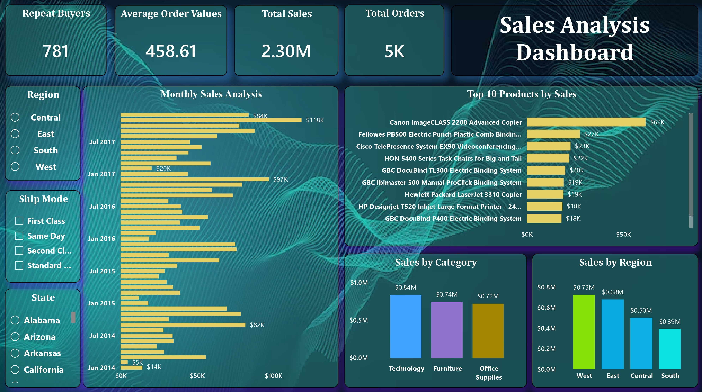

# NEXLEVR – Sales Analysis Dashboard

## Project Overview
This project analyzes the Sample Superstore dataset using Power BI to understand sales performance, customer behavior, and regional trends.

## Tools Used
- Power BI
- Microsoft Excel
- Sample Superstore Dataset

## Key Analysis
- Total Sales and Total Orders
- Average Order Value
- Monthly Sales Trends
- Sales by Region
- Top 10 Products by Sales
- Sales by Category
- Repeat Buyers and Repeat Buyer Percentage

## Dashboard
The interactive dashboard includes KPI cards, charts, and slicers to explore sales performance across different regions, categories, and shipping modes.

## Objective
To identify sales trends, understand customer purchasing behavior, and provide useful business insights through data visualization.

## Internship
NEXLEVR – Data Analyst Internship

## Dashboard Preview

